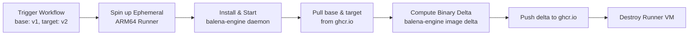

# Over-The-Air (OTA) Binary Delta Updates Workflow

Documentation for the CI/CD delta image generation pipeline defined in [`.github/workflows/delta.yml`](file:///.github/workflows/delta.yml) and the edge deployment procedure for the robot fleet.

---

## 1. Problem Statement

### The Challenge with Edge Robotics Updates
* **Massive Container Images**: Production ROS 2 robotics images containing Nav2, Gazebo Harmonic, perception stacks, and system libraries often reach **3 GB to 8 GB+**.
* **Bandwidth & Connectivity Constraints**: Autonomous Guided Vehicles (AGVs) operating in warehouses or industrial facilities rely on industrial Wi-Fi or cellular (LTE/5G) networks with limited throughput, data quotas, and intermittent disconnects.
* **Cost & Downtime**: Pulling multi-gigabyte container updates directly to every robot in a fleet takes excessive time, increases robot downtime, and risks corrupted or incomplete downloads mid-shift.

---

## 2. Solution: Binary Delta Compression

Instead of downloading the entire new image (`v2`), the robot only downloads a **binary delta** (the byte-level differences between `v1` and `v2`).

* **Balena-Engine**: Uses delta algorithms tailored for container layers to extract only the changed bytes between two images.
* **Bandwidth Reduction**: Often reduces update payload size by **80% – 95%** (e.g., a 4 GB update compressed down to 50–150 MB).
* **Deterministic Output**: The locally reconstructed image on the robot has the identical cryptographic hash and layers as the original target image built in CI.

---

## 3. Workflow Overview (`delta.yml`)

The pipeline runs on-demand via GitHub Actions using an ARM64 Linux runner (`ubuntu-24.04-arm`) matching the robot's target architecture.



### Key Workflow Inputs
| Input | Default | Description |
| :--- | :--- | :--- |
| `base` | `v1` | Image tag already deployed on the physical robot. |
| `target` | `v2` | New image tag to update the robot to. |

---

## 4. Delta Generation Commands (CI / Server Side)

These commands run automatically in the GitHub Actions workflow runner ([.github/workflows/delta.yml](file:///.github/workflows/delta.yml)):

```bash
# 1. Download and install balena-engine binary (ARM64)
curl -sL https://github.com/balena-os/balena-engine/releases/download/v20.10.43/balena-engine-v20.10.43-arm64.tar.gz \
  | sudo tar -xz -C /usr/local/bin

# 2. Start the balena-engine daemon in the background
sudo balena-engine-daemon &
sleep 3

# 3. Authenticate with GitHub Container Registry
echo "$BALENA_TOKEN" | sudo balena-engine login ghcr.io -u <GITHUB_ACTOR> --password-stdin

# 4. Pull base (current robot version) and target (new version) images
REPO="ghcr.io/<OWNER>/<REPO>"
sudo balena-engine pull "$REPO:v1"
sudo balena-engine pull "$REPO:v2"

# 5. Compute binary delta between base and target
sudo balena-engine image delta \
  -t "$REPO:delta-v1-to-v2" \
  "$REPO:v1" \
  "$REPO:v2"

# 6. Push the lightweight delta image to the container registry
sudo balena-engine push "$REPO:delta-v1-to-v2"
```

---

## 5. Robot-Side Commands (Edge AGV)

On the physical robot running Linux and `balena-engine`, perform the following commands to pull the delta and restart the stack:

### Step 1: Authenticate to Container Registry
```bash
echo "$ROBOT_PULL_TOKEN" | balena-engine login ghcr.io -u <GITHUB_USER> --password-stdin
```

### Step 2: Verify Current Base Image is Present Locally
The local base image (`v1`) must exist on the robot so the engine can calculate and apply the diff:
```bash
balena-engine images | grep "v1"
```

### Step 3: Pull the Delta Image
Pull the delta image generated by CI. `balena-engine` automatically detects the delta layer, applies the diff against the local `v1` base image, and reconstructs the full `v2` image:
```bash
balena-engine pull ghcr.io/<OWNER>/<REPO>:delta-v1-to-v2
```

### Step 4: Verify the Reconstructed Target Image
Verify that `v2` is now fully available locally in the image cache:
```bash
balena-engine images
```

### Step 5: Transition the Running Container to the New Version
Stop the currently running container and start the new image:
```bash
# Stop and remove the existing robot container
balena-engine stop agv_robot
balena-engine rm agv_robot

# Run the updated target version
balena-engine run -d \
  --name agv_robot \
  --restart always \
  --net host \
  --ipc host \
  ghcr.io/<OWNER>/<REPO>:v2
```

### Step 6: (Optional) Cleanup Obsolete Base Images
Once `v2` is validated and becomes the new base, remove obsolete images to free flash/disk storage:
```bash
balena-engine rmi ghcr.io/<OWNER>/<REPO>:delta-v1-to-v2
balena-engine rmi ghcr.io/<OWNER>/<REPO>:v1
```

---

## 6. Lifecycle & Storage: What Stays vs. What Gets Deleted

| Component | Lifecycle | Location | Notes |
| :--- | :--- | :--- | :--- |
| **Runner VM & OS** | **Deleted** | GitHub Cloud | The `ubuntu-24.04-arm` runner is ephemeral. The entire VM is wiped upon job completion. |
| **Downloaded Base/Target Images** | **Deleted** | Runner Local Disk | Temporary image files pulled into the daemon are discarded when the VM terminates. |
| **Installed Balena Daemon** | **Deleted** | Runner `/usr/local/bin` | Exists only for the duration of the workflow step. |
| **Delta Image Artifact** | **Persists** | `ghcr.io/<repo>:delta-v1-to-v2` | Stored in GitHub Container Registry until manually removed or pruned via retention rules. |
| **Workflow Run Logs** | **Persists** | GitHub Actions History | Retained per repository retention settings (typically 90 days). |
| **`delta.yml` File** | **Persists** | Git Repository (`.github/workflows/`) | Permanent version-controlled pipeline configuration. |

---

## 7. Official Documentation & References

* **balenaEngine GitHub Repository**: [github.com/balena-os/balena-engine](https://github.com/balena-os/balena-engine)
* **balenaEngine Official Documentation**: [balena.io/docs/reference/OS/overview/2.X/#balenaengine](https://www.balena.io/docs/reference/OS/overview/2.X/#balenaengine)
* **Balena Container Deltas Overview**: [balena.io/blog/hands-on-with-docker-deltas-2/](https://www.balena.io/blog/hands-on-with-docker-deltas-2/)
* **balenaEngine Releases (ARM64 / x86_64)**: [github.com/balena-os/balena-engine/releases](https://github.com/balena-os/balena-engine/releases)
